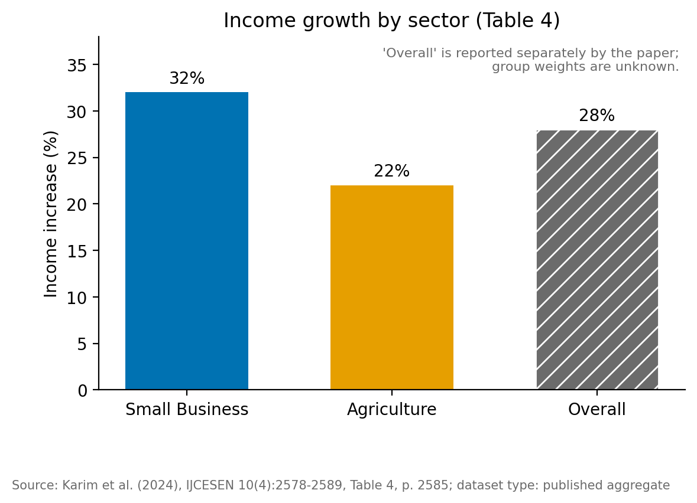
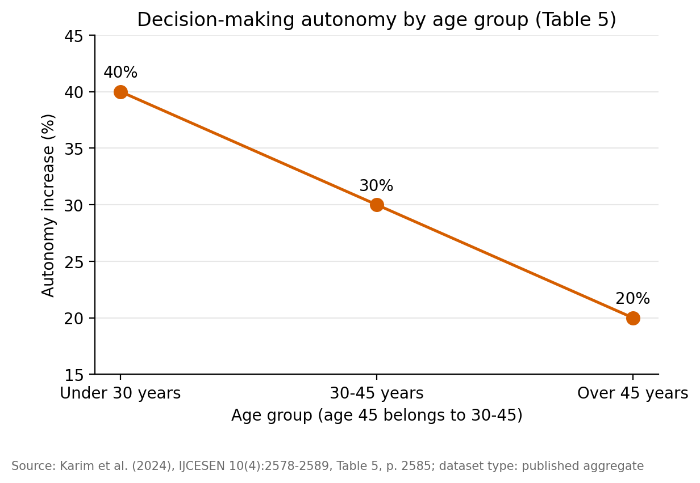
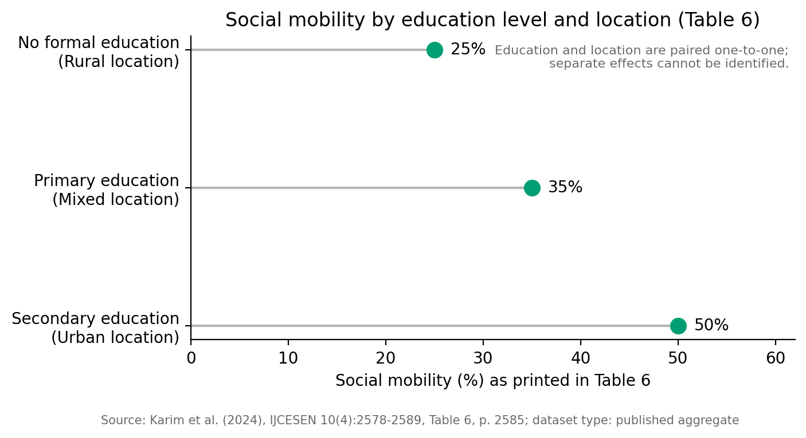
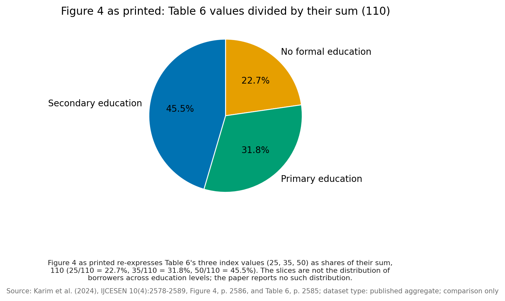
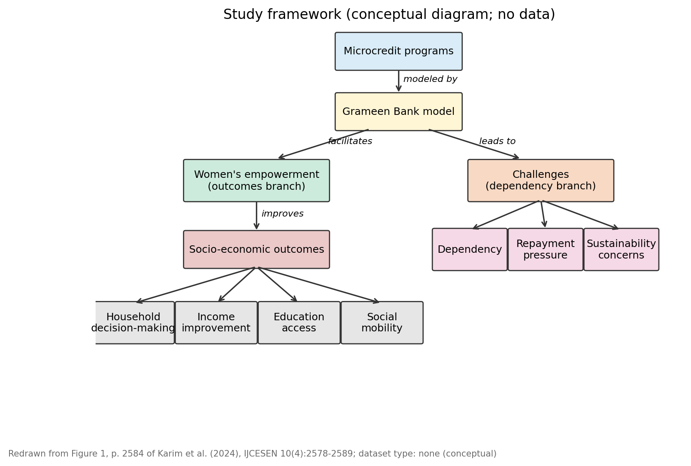

# Report: Grameen microcredit companion

Companion to Karim et al. (2024), IJCESEN 10(4):2578-2589, https://doi.org/10.22399/ijcesen.4074.

## 1. What came from where
| result | origin | dataset_type | command |
|---|---|---|---|
| Figures 1-4 and Tables 4-6 values | the publication (Karim et al. 2024) | published_aggregate | grameen reproduce-paper |
| Regression coefficients, fit statistics | a synthetic run | synthetic | grameen run-synthetic |
| Qualitative joint display | passages reported in the publication, single annotator | published_aggregate + paper-reported passages | grameen build-report |
| World Bank / BIDS survey estimates | independent microdata, NOT run | independent_bids | grameen import-bids |
| Fits to the authors' original microdata | NOT run: data held by the corresponding author | original_microdata | grameen fit-models |

## 2. Published summary values (publication)
Percentages as printed; no denominators, variances or coefficients exist in the paper. Overall values are reported separately and are not derived from subgroup means.
| record_id | source_location | printed_page | group_label | secondary_label | value | change_basis |
|---|---|---|---|---|---|---|
| T4-01 | Table 4, Average Income Growth by Sector | 2585 | Small Business |  | 32 | percent_increase |
| T4-02 | Table 4, Average Income Growth by Sector | 2585 | Agriculture |  | 22 | percent_increase |
| T4-03 | Table 4, Average Income Growth by Sector | 2585 | Overall |  | 28 | percent_increase |
| T5-01 | Table 5, Increase in Decision-Making Autonomy by Age Group | 2585 | Under 30 years |  | 40 | not_stated |
| T5-02 | Table 5, Increase in Decision-Making Autonomy by Age Group | 2585 | 30-45 years |  | 30 | not_stated |
| T5-03 | Table 5, Increase in Decision-Making Autonomy by Age Group | 2585 | Over 45 years |  | 20 | not_stated |
| T6-01 | Table 6, Social Mobility Index by Education and Location | 2585 | No formal education | Rural | 25 | level_percent_unspecified |
| T6-02 | Table 6, Social Mobility Index by Education and Location | 2585 | Primary education | Mixed | 35 | level_percent_unspecified |
| T6-03 | Table 6, Social Mobility Index by Education and Location | 2585 | Secondary education | Urban | 50 | level_percent_unspecified |
| N-01 | Section 4, paragraph 2 (income) | 2582 | Overall |  | 28 | percent_increase |
| N-02 | Section 4, paragraph 2 (income by sector) | 2582 | Small Business |  | 32 | percent_increase |
| N-03 | Section 4, paragraph 2 (income by sector) | 2582 | Agriculture |  | 22 | percent_increase |
| N-04 | Section 4, paragraph 3 (autonomy) | 2583 | Overall |  | 35 | not_stated |
| N-05 | Section 4, paragraph 3 (autonomy by age) | 2583 | Under 30 years |  | 40 | not_stated |
| N-06 | Section 4, paragraph 3 (autonomy by age) | 2583 | 30-45 years |  | 30 | not_stated |
| N-07 | Section 4, paragraph 3 (social mobility) | 2583 | Overall |  | 40 | not_stated |

## 3. Figure 4 discrepancy
Figure 4 as printed re-expresses Table 6's three index values (25, 35, 50) as shares of their sum, 110 (25/110 = 22.7%, 35/110 = 31.8%, 50/110 = 45.5%). The slices are not the distribution of borrowers across education levels; the paper reports no such distribution.

## 4. Regression (synthetic demonstration)
> **SYNTHETIC.** Every number below comes from a fictional fixture generated by `grameen run-synthetic`. It demonstrates that the code runs. It is not the paper's data, not calibrated to the paper, and says nothing about microcredit.

12 fitted models; see [synthetic_regression_report.md](../results/synthetic/synthetic_regression_report.md).

## 5. Joint display (qualitative evidence reported in the paper)
Single annotator working from passages reported in the paper; counts are annotated passages, not prevalence; no coder agreement exists.

| finding_id | subgroup | quantitative_finding | qualitative_status | evidence_pattern |
|---|---|---|---|---|
| J1 | all women | income_increase = 28% (percent_increase) | tension | convergent: financial_independence; divergent: reliance_on_repeated_borrowing, repayment_stress |
| J2 | sector: Small Business | income_increase = 32% (percent_increase) | tension | convergent: financial_independence; divergent: repayment_stress |
| J3 | sector: Agriculture | income_increase = 22% (percent_increase) | divergent | divergent: repayment_stress |
| J4 | all women | decision_making_autonomy_increase = 35% (not_stated) | tension | divergent: continued_family_control; mixed: household_decision_authority |
| J5 | age_group: Under 30 years | decision_making_autonomy_increase = 40% (not_stated) | insufficient evidence | insufficient evidence |
| J6 | age_group: 30-45 years | decision_making_autonomy_increase = 30% (not_stated) | insufficient evidence | insufficient evidence |
| J7 | age_group: Over 45 years | decision_making_autonomy_increase = 20% (not_stated) | insufficient evidence | insufficient evidence |
| J8 | all women | community_participation_increase = 40% (not_stated) | convergent | convergent: community_participation |
| J9 | education_level: No formal education | social_mobility_index = 25% (level_percent_unspecified) | insufficient evidence | insufficient evidence |
| J10 | education_level: Primary education | social_mobility_index = 35% (level_percent_unspecified) | insufficient evidence | insufficient evidence |
| J11 | education_level: Secondary education | social_mobility_index = 50% (level_percent_unspecified) | insufficient evidence | insufficient evidence |

## 6. Not done
- Fits to the authors' original microdata: the paper directs requests to the corresponding author.
- World Bank / BIDS estimates: need a local licensed download (`docs/BIDS_ACCESS.md`).
